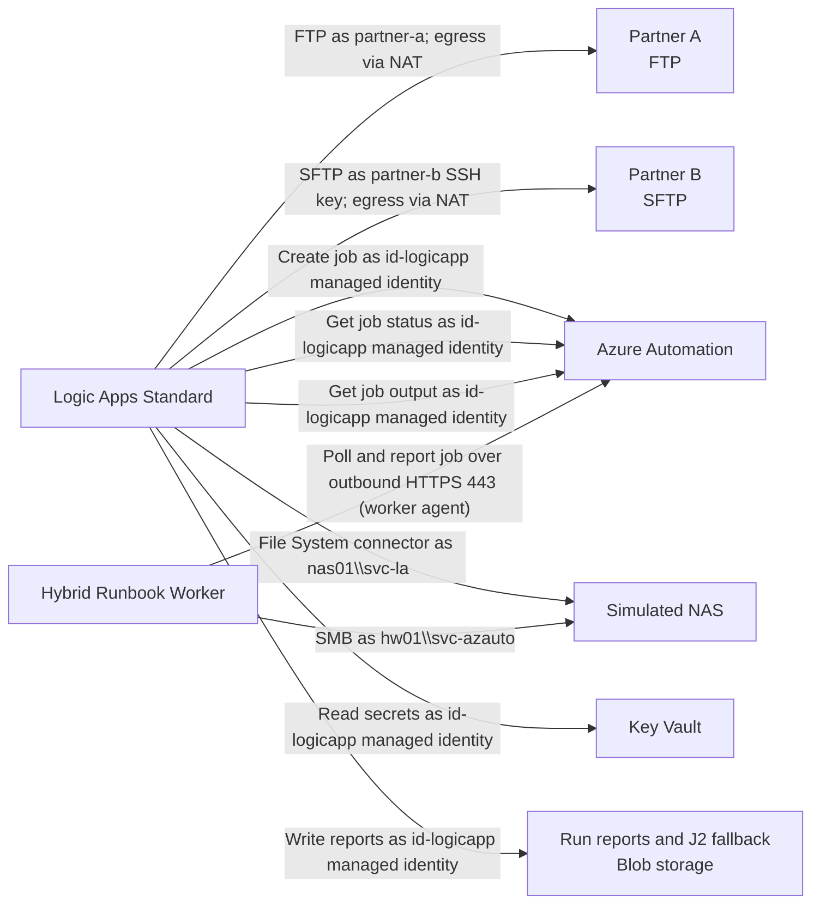

# Orchestrator to Logic Apps Standard migration spike

**Question:** Can scheduled and folder-monitoring System Center Orchestrator jobs, including jobs that use on-premises file shares and local tools, run on Azure Logic Apps Standard with Azure Automation hybrid workers, reliably, idempotently and observably?

**Time box:** Ready by 2026-11-23 · **Status:** in progress

## The setup

The Logic App Standard workflows run in Azure and handle partner transfers, NAS access, and scheduled jobs. A simulated partner VM accepts FTP and SFTP traffic through the Logic App subnet's NAT Gateway. For J3, Logic Apps starts an Azure Automation runbook on a Hybrid Runbook Worker VM; the worker uses a local CSV-to-JSON tool and accesses the simulated NAS. These Azure VMs and VNet peering represent the partner network and datacenter; production connectivity and identities will differ.

Workflow calls use the Logic App managed identity for Azure services, `nas01\svc-la` for NAS access from the File System connector, `hw01\svc-azauto` for worker SMB access, and the partner accounts for FTP/SFTP. The worker agent polls Automation over outbound HTTPS.



## Key findings

TODO: once the first experiments are done, one line per question (a table), and a diagram of the most important
behaviour when it helps (a `sequenceDiagram`).

The answers to every question, with the evidence: **[docs/FINDINGS.md](docs/FINDINGS.md)**.

## Documents

| Document | Content |
|---|---|
| [Specification](docs/SPEC.md) | What the spike builds: topology, workflows, tests, acceptance criteria |
| [Decisions](docs/DECISIONS.md) | Choices, simplifications against production, VERIFY outcomes |
| [Questions](docs/QUESTIONS.md) | What the spike must answer, and the status of each question |
| [Experiments](docs/experiments/README.md) | One file per experiment, numbered |
| [Findings](docs/FINDINGS.md) | The answers, with links to the evidence |
| [Retest plan](docs/RETEST-PLAN.md) | What to run again when a product changes |
| [Demo runbook](docs/DEMO-RUNBOOK.md) | How to show the results |

## Environment

### Prerequisites

Install Azure CLI, Azure Developer CLI (`azd`), Terraform, PowerShell 7, and `curl`. Authenticate both CLIs with the account that will provision the environment:

```sh
az login
azd auth login
```

### Provision and deploy

The infrastructure is one Terraform root in `infra/`; `azd provision` runs its configured hooks. Create an environment, set the source IP that will seed partner data, and provide any tags required by your subscription policies. Replace the tag values with placeholders appropriate to your environment; do not put tenant-specific values in repository files.

```sh
azd env new <environment-name> --location francecentral
azd env set DEPLOYER_IP "<your-public-ip>"
azd env set RESOURCE_TAGS "key=value,key=value"
```

The settings below are optional and have the defaults mapped in `infra/main.tfvars.json`. Set only the values you need with `azd env set <NAME> <value>`. `DEPLOYER_IP` is required as well as the environment name, subscription, and location.

| Setting | Default | Purpose |
|---|---:|---|
| `ENABLE_BASTION` | `false` | Create Azure Bastion for VM administration. |
| `ALERT_EMAIL` | empty | Email receiver for Azure Monitor alerts. |
| `CRITICAL_JOB_DEADLINE_HOURS` | `1` | Deadline window for the critical-job alert. |
| `VM_SIZE` | `Standard_D2als_v7` | Size for all VMs (2 vCPU, 4 GiB). |
| `ENABLE_SECOND_WORKER` | `false` | Create a second Hybrid Runbook Worker. |
| `ENABLE_FTPS` | `false` | Enable optional FTPS on the simulated partner. |
| `AUTO_SHUTDOWN_TIME` | `2000` | Daily VM shutdown time in 24-hour `HHMM` format. |
| `VM_SCRIPT_SOURCE_REF` | `main` | Git ref used to fetch VM setup scripts. |
| `AUTOMATION_RUNTIME_VERSION` | `7.4` | PowerShell runtime version for Automation. |
| `WORKER_RUN_AS_CUSTOM_CREDENTIAL` | `true` | Run Automation jobs with the worker-group credential. |
| `PARTNER_FTP_PORT` | `2121` | FTP control port on the simulated partner. |
| `PARTNER_SFTP_PORT` | `2222` | SFTP port on the simulated partner. |

Review the whole Terraform plan before applying it:

```sh
azd provision --preview
azd provision
```

The `azure.logicappsstandard` azd extension is not used. Experiment 01 V3 records the scripted deployment path as the primary path. Export the two values required by the deployment script from the selected azd environment, then deploy and verify the workflows:

```sh
export AZURE_RESOURCE_GROUP="$(azd env get-value AZURE_RESOURCE_GROUP)"
export LOGIC_APP_NAME="$(azd env get-value LOGIC_APP_NAME)"
bash scripts/deploy-logicapp.sh
```

PowerShell 7 operators can use `pwsh -File scripts/deploy-logicapp.ps1` after setting those same two environment variables.

### Start, stop, and cost

The default deployment has three VMs (NAS, worker, and partner), each using `Standard_D2als_v7` (2 vCPU, 4 GiB); enabling the second worker adds a fourth VM. They have a daily auto-shutdown schedule at 20:00 Romance Standard Time. To start them again, or to shut them down before the schedule, use the resource group and VM names printed by `azd env get-values`:

```sh
resource_group="$(azd env get-value AZURE_RESOURCE_GROUP)"
az vm start --resource-group "$resource_group" --name "$(azd env get-value NAS_VM_NAME)"
az vm start --resource-group "$resource_group" --name "$(azd env get-value PARTNER_VM_NAME)"
IFS=, read -r -a workers <<< "$(azd env get-value WORKER_VM_NAMES)"
for worker in "${workers[@]}"; do
  az vm start --resource-group "$resource_group" --name "$worker"
done
```

Replace `start` with `deallocate` in those commands to stop VM compute charges when the VMs are not in use. The main daily cost drivers are three (or four) `Standard_D2als_v7` VMs for their powered-on hours and the Windows Logic Apps Standard `WS1` plan, which remains provisioned when VMs are stopped; storage and networking add usage-dependent charges. For a daily estimate, enter the region (`francecentral`), VM count and powered-on hours, and a 24-hour `WS1` plan in the [Azure Pricing Calculator](https://azure.microsoft.com/pricing/calculator/). No fixed price is stated here because rates depend on region, agreement, and usage.

To remove the environment and its resources when finished:

```sh
azd down --purge
```

## Run the tests

Run the scenario suite with PowerShell 7 from the repository root:

```powershell
pwsh -File tests/run-all.ps1
```

Use `-Only` to select scenario IDs (comma-separated or as an array), and `-IncludeAlerts` to include alert scenarios:

```powershell
pwsh -File tests/run-all.ps1 -Only T02,T08
pwsh -File tests/run-all.ps1 -IncludeAlerts
pwsh -File tests/run-all.ps1 -Only T16,T17 -IncludeAlerts
```

When scenario scripts are present under `tests/scenarios/`, the runner prints a summary and writes the results to [docs/TEST-REPORT.md](docs/TEST-REPORT.md). A full run checks the mandatory scenarios; `-Only` runs only the requested scenarios. This checkout does not yet include the live scenario scripts, so the commands cannot run the Azure scenarios or produce the report until those files are added.

## Run the experiments' code

```bash
uv sync
uv run python src/<script>.py
```
