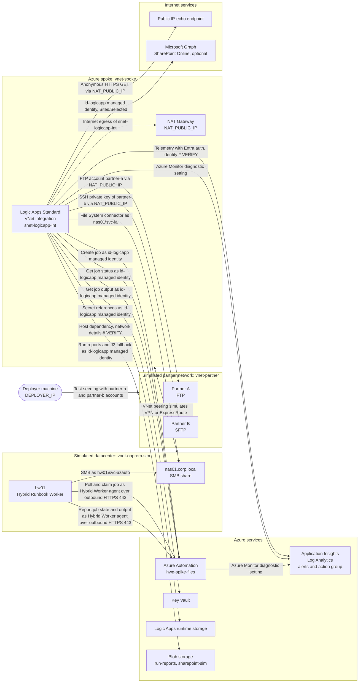
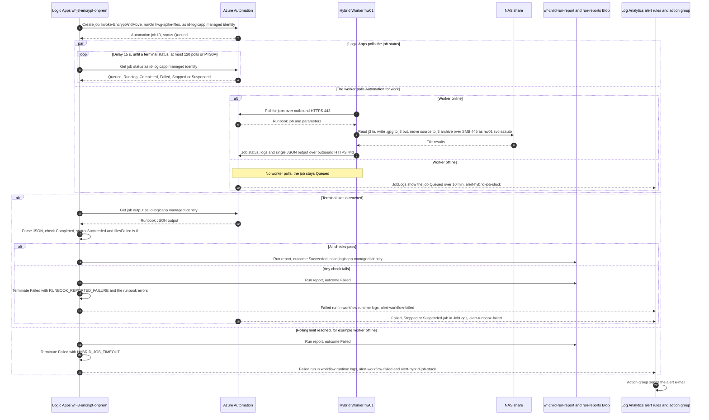

# Architecture

These diagrams describe the target design in [SPEC §3](SPEC.md#3-target-topology-what-terraform-must-create) and [SPEC §5](SPEC.md#5-workflows--detailed-specification). They are not a deployment report. The partner network and datacenter are simulated for the spike.

## Topology

`vnet-partner` is not peered. The Logic App uses VNet integration with Route All, so its Internet-bound workflow traffic leaves `snet-logicapp-int` through the NAT Gateway (dotted arrow: an egress path, not a call). The partner VM allows only the NAT public IP and the deployer IP. The simulated datacenter is reached through VNet peering. Optional parts are not shown: private endpoints for Key Vault and storage, Bastion, and the second worker `hw02`.

The Logic Apps host also depends on runtime storage. The specification does not state that host connection's port, protocol, or identity; those details are marked `# VERIFY`. This is separate from the workflow's managed-identity connection to the `run-reports` Blob container.

The Automation arrows represent the logical create-job, get-status, and get-output calls. Whether to use the built-in connector or the ARM REST fallback, and the REST API version if used, remain `# VERIFY` as noted in SPEC §5.1.

## Network flows

| From | To | Port | Protocol | Purpose |
|---|---|---:|---|---|
| Logic Apps integration subnet | Partner A FTP endpoint, through NAT Gateway | TCP 21 and 40000–40100 | FTP, passive mode | List, retrieve, and archive partner files using `partner-a` credentials. |
| Logic Apps integration subnet | Partner B SFTP endpoint, through NAT Gateway | TCP 22 | SFTP over SSH | Deliver files as `partner-b` with the SSH private key. |
| Logic Apps integration subnet | Public IP-echo endpoint, through NAT Gateway | TCP 443 | HTTPS | `wf-diag-egress-ip` shows the source IP partners see, expected to equal `NAT_PUBLIC_IP`. |
| Logic Apps integration subnet | Microsoft Graph, through NAT Gateway (optional, `enable_sharepoint`) | TCP 443 | HTTPS | J2 uploads to SharePoint Online as `id-logicapp` managed identity with `Sites.Selected`. |
| Deployer machine | Partner VM | TCP 21, 40000–40100 and 22 | FTP and SFTP | Test seeding and checks with `curl`, allowed by the partner NSG for `DEPLOYER_IP`. |
| Logic Apps integration subnet | `nas01.corp.local` | TCP 445 | SMB | Built-in File System connector accesses NAS folders as `nas01\svc-la`. |
| Hybrid Runbook Worker | `nas01.corp.local` | TCP 445 | SMB | Runbook reads, writes, and archives J3 files as `hw01\svc-azauto`; the local account is mirrored on the NAS VM. |
| Hybrid Runbook Worker | Azure Automation | Outbound TCP 443 | HTTPS | Worker agent polls for jobs and reports job state and output. |
| Logic Apps | Azure Automation | TCP 443 | HTTPS | Create a Hybrid Worker job, check its status, and retrieve its output as `id-logicapp` managed identity. |
| Logic Apps | Key Vault | TCP 443 | HTTPS | Resolve workflow secrets using `id-logicapp` managed identity. |
| Logic Apps | Blob storage (`run-reports`, `sharepoint-sim`) | TCP 443 | HTTPS | Write run reports and the J2 fallback files using `id-logicapp` managed identity. |
| Logic Apps | Application Insights | TCP 443 | HTTPS | Send telemetry; ingestion accepts only Entra authentication. Identity used: `# VERIFY`. |
| Logic Apps and Azure Automation | Log Analytics | N/A | Azure Monitor diagnostic settings | Export workflow and Automation diagnostics. This is a platform diagnostic path, not a workload network connection. |
| Logic Apps host | Runtime storage account | `# VERIFY` | `# VERIFY` | Host runtime dependency. The specification does not define the network port, protocol, or identity. |

Network ranges, peering, and port rules follow [SPEC §3.1](SPEC.md#31-networks), [§3.4](SPEC.md#34-azure-automation), and the connector calls in [§5](SPEC.md#5-workflows--detailed-specification). The NSG on `snet-servers` allows TCP 445 to `nas01` only from `snet-logicapp-int` (10.10.1.0/26) and from `hw01`, and outbound 443 for the worker.

## P3 sequence: encrypt files on the NAS

The worker only makes outbound HTTPS connections: it polls Automation for jobs, so nothing connects in to the datacenter. Logic Apps starts the job, then polls its status ("start then poll") instead of waiting synchronously, so a stuck job is detected. When no worker picks the job up, it stays *Queued*: after 10 minutes `alert-hybrid-job-stuck` fires, and at the polling limit (120 polls or 30 minutes) the run fails with `HYBRID_JOB_TIMEOUT`. A runbook that ends with failed files fails the run with `RUNBOOK_REPORTED_FAILURE`. On every path the child workflow `wf-child-run-report` writes a run report before the run ends. Dashed arrows are diagnostic logs evaluated by the alert rules, not calls. The alert queries' tables and columns are `# VERIFY` after the first runs. See [SPEC §5.0](SPEC.md#50-conventions-for-all-workflows), [§5.5](SPEC.md#55-wf-j3-encrypt-onprem--j3-pattern-p3) and [§6](SPEC.md#6-monitoring-and-alerts).

## Workflow patterns

- **P0 — Cloud only:** Logic Apps and built-in connectors handle the work without an on-premises agent. J1 and J2 use this pattern.
- **P1 — Agentless hybrid:** Logic Apps accesses the NAS directly through VNet integration and the File System connector. No worker runs the workflow. J4 uses P0 and P1; the optional folder-watch workflow uses P1.
- **P2 — Data gateway:** A managed connector reaches on-premises data through a gateway. This is a fallback pattern and is not built in the spike.
- **P3 — Hybrid worker:** Logic Apps starts an Azure Automation runbook on a Hybrid Runbook Worker for work that needs local files or tools, such as J3 encryption.

## Simplifications from production

- **Network link:** VNet peering between the spoke and simulated datacenter stands in for VPN or ExpressRoute.
- **Worker hosting:** The Hybrid Runbook Worker runs on an Azure VM rather than an Azure Arc-enabled datacenter server.
- **File-share identity:** Local accounts, including a mirrored `svc-azauto` account for SMB access, stand in for domain accounts managed by Active Directory.
